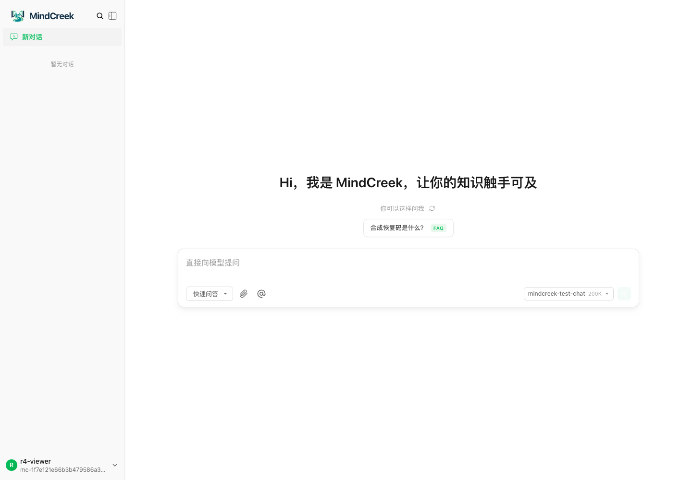
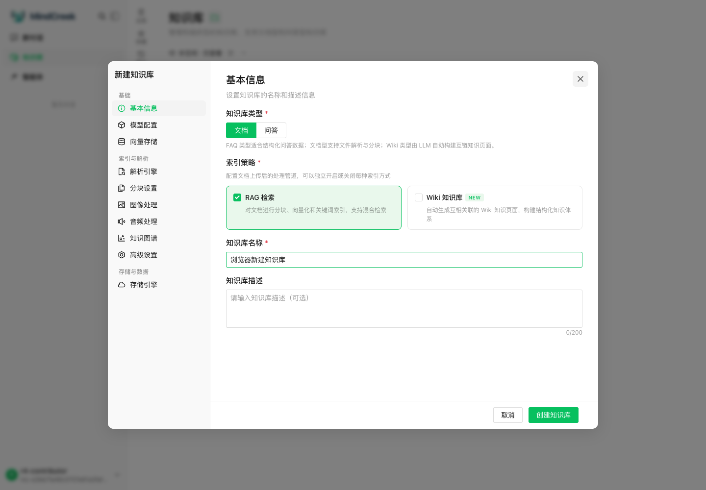
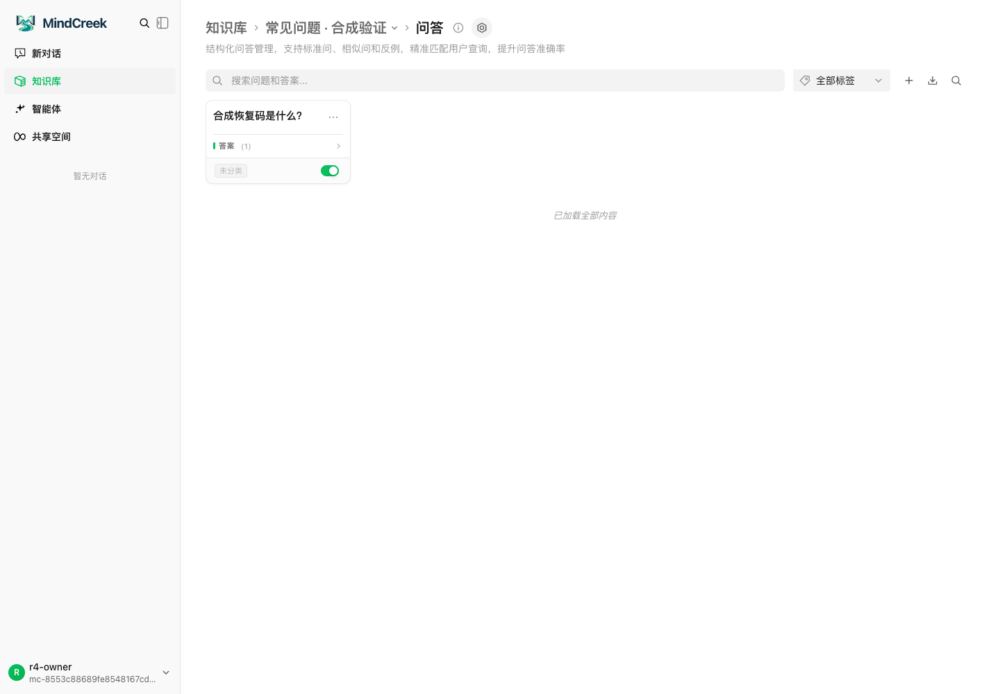
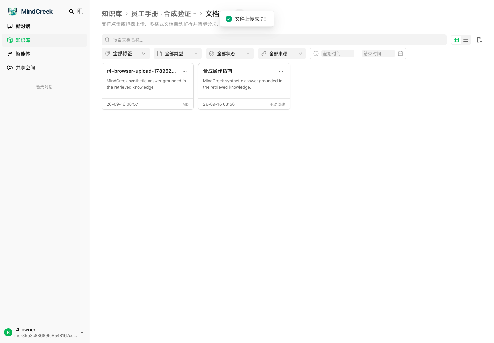
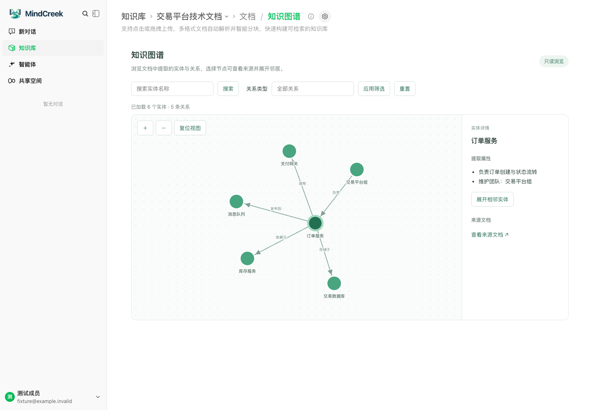
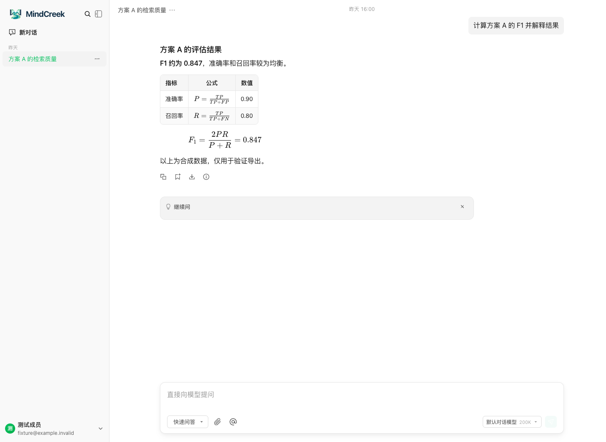
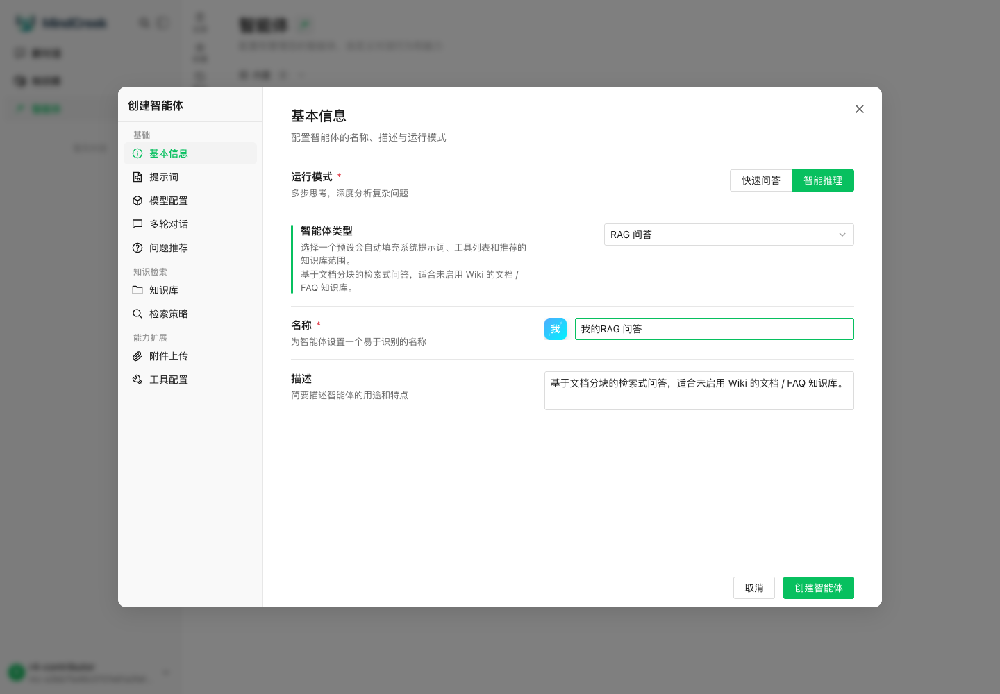
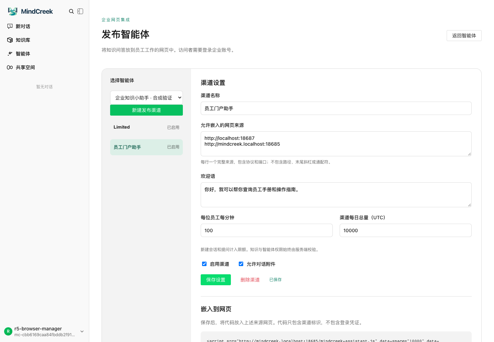
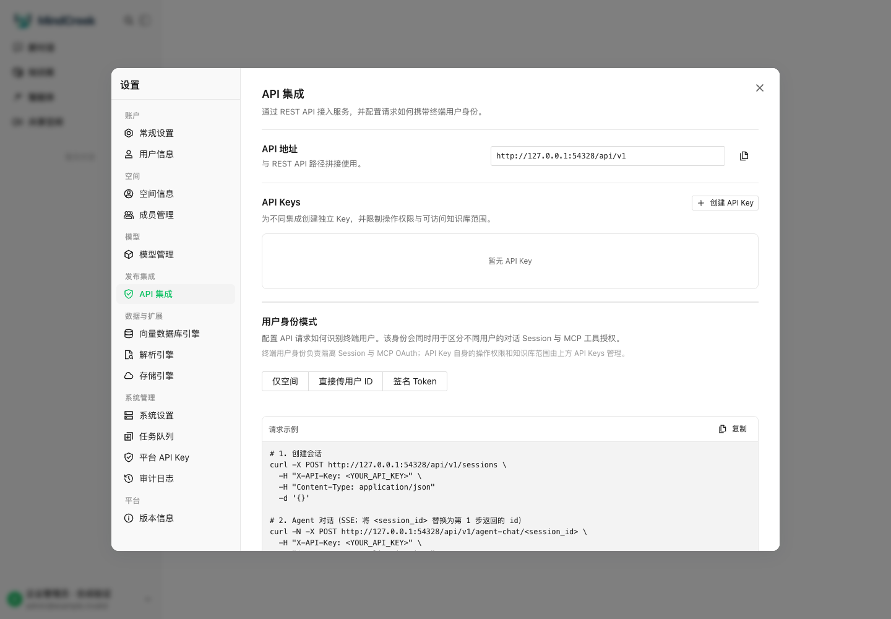

# MindCreek 使用手册

知识库、知识管理、智能体、MCP 和 API

版本：1.0。更新日期：2026-10-10。

适用版本：`current-20261009-a86981ad` 企业部署包及对应源码 `9d7aa1a`。上游基线为 WeKnora v0.8.0。

## 1 阅读说明

本手册供企业员工、知识维护者、空间所有者和集成开发者使用。
本手册说明日常操作。服务器安装和升级见[部署与升级指南](ENTERPRISE_DEPLOYMENT_AND_UPGRADE_ZH.md)。

### 1.1 写作方式

本手册采用 ASD-STE100 的写作原则：使用短句、主动语态、固定术语和单项操作步骤。
条件放在操作前。操作结果与操作步骤分开。
注意事项放在有风险的操作前。

ASD-STE100 是受控英语标准。中文稿不能声称通过其英语词典和句长规则检查。
本手册是按 STE 原则编写的中文操作手册，不是经认证的 STE 英文文件。
标准依据见 [ASD 官方介绍](https://www.asd-ste100.org/about_STE.html)和 [Issue 9 第 5 节](https://www.asd-ste100.org/assets/files/ASD-STE100_ISSUE9.pdf)。

### 1.2 阅读路径

| 读者 | 先阅读 | 完成目标 |
|---|---|---|
| 普通员工 | 第 2、5 节 | 登录、选择知识范围、提问、核对引用 |
| 知识维护者 | 第 2 至 6 节 | 建库、导入、检查、维护、配置智能体 |
| 空间所有者 | 第 2、7、8 节 | 确认权限、发布员工小助手、发放受限 Key |
| 集成开发者 | 第 8 至 11 节 | 使用 MCP 或 API 访问指定知识库 |

### 1.3 示例约定

- `https://mindcreek.com` 是示例服务地址。实际操作使用企业提供的地址。
- `https://portal.example.com` 是示例门户地址。
- `<KB_ID>`、`<AGENT_ID>`、`<SESSION_ID>` 是占位符。实际请求使用服务返回的 ID。
- 截图使用合成账号和合成资料。截图中的域名、端口、模型名和限额不是部署参数。
- 配图选自现有合成验证。个别旧配图未显示后来增加的页签。操作以本手册文字和当前权限为准。
- 示例不使用公司真实身份、模型密钥或业务文档。

## 2 登录与权限

### 2.1 统一术语

| 术语 | 本手册中的含义 |
|---|---|
| 空间 | 员工成员关系和角色所属的工作区。API 使用 `tenant_id` 标识 |
| 知识库 | 空间内的一组知识及其解析、索引配置 |
| 文档 | 上传或手动创建的一条知识记录。API 通常使用 `knowledge_id` 标识 |
| 分块 | 文档解析后产生的片段。检索结果通常指向分块 |
| FAQ | 标准问题、相似问题和标准答案组成的问答知识 |
| Wiki | 根据资料生成或维护的知识页面及页面链接 |
| 知识图谱 | 从资料提取的实体及实体关系 |
| 智能体 | 具有提示词、模型、知识范围和工具配置的问答助手 |
| 引用 | 回答所依据的知识片段或来源信息 |
| 会话 | 同一调用身份下的一段对话 |
| API Key | 供程序使用的机器凭据。Key 的能力与知识库范围由服务器检查 |
| Bearer 令牌 | MindCreek 登录后签发的用户访问令牌 |

“共享空间”是原生资源共享功能的界面名称。
它与左下角切换的账号空间不是同一个设置入口。
不要把加入共享空间等同于获得另一个账号空间的 Owner 角色。

### 2.2 员工登录

**前提：** 管理员已配置企业登录和默认空间。

1. 打开企业提供的 MindCreek 地址。
2. 如果页面进入企业登录，使用企业账号完成认证。
3. 如果页面显示开户处理中，等待开户结束。
4. 如果开户失败，使用页面的重试或刷新状态入口。

**结果：** 首次登录的员工自动建号，并以 Viewer 加入默认空间。
系统不为每位员工创建个人空间。
已有有效会话时，主页直接进入可访问空间。

被移除的员工不会因再次登录而自动加入原空间。
如果没有其他可访问空间，页面显示受限状态。
此时由空间 Owner 处理成员关系。

### 2.3 本地管理员登录

1. 打开 `https://mindcreek.com/admin/login`。
2. 输入部署时配置的本地管理员凭据。
3. 点击登录。

**结果：** 管理员进入同一产品界面。
本地 admin 与同邮箱的企业员工仍是不同身份。
平台管理员身份不会随空间所有权移交。
平台管理员身份也不自动授予全部空间的知识读取权限。

### 2.4 选择空间

1. 点击左下角用户菜单。
2. 打开空间切换列表。
3. 选择目标空间。
4. 核对当前空间名称。

**结果：** 知识库、智能体和角色按所选空间生效。
没有目标空间时，请空间 Owner 添加成员。

### 2.5 角色与入口

下表说明正常工作方式。后端还检查资源创建者和共享权限。

| 操作 | Owner 所有者 | Admin 管理员 | Contributor 编辑 | Viewer 访客 |
|---|---|---|---|---|
| 在对话页提问 | 有权资源 | 有权资源 | 有权资源 | 有权资源 |
| 查看知识库和智能体管理入口 | 可以 | 可以 | 可以 | 隐藏 |
| 创建知识库和智能体 | 可以 | 可以 | 可以 | 不可以 |
| 修改或删除现有知识库、智能体 | 本空间规则内 | 本空间规则内 | 以自建资源为主 | 无管理导航 |
| 查看知识图谱页 | 本空间有权知识库 | 本空间有权知识库 | 本空间有权知识库 | 不可以 |
| 管理员工网页发布渠道 | 可以 | 可以 | 不可以 | 不可以 |
| 添加成员、改角色、移除成员 | 可以 | 不可以 | 不可以 | 不可以 |
| 管理空间 API Key | 可以 | 不可以 | 不可以 | 不可以 |

**权限注意：** 隐藏导航不等于撤销后端资源权限。
原生部分写接口允许资源创建者操作。
创建者降为 Viewer 后，部分创建者权限可能仍然有效。
需要彻底停止访问时，由 Owner 处理成员关系和独立机器 Key。

知识库属于空间。创建知识库不等于创建个人私密库。
敏感资料应放入经过授权的独立空间。



图 1：Viewer 可在对话页选择智能体和知识范围。左侧不显示知识库管理入口。

## 3 创建知识库

### 3.1 选择知识组织方式

| 需求 | 选择 | 准备内容 |
|---|---|---|
| 检索制度、说明书或操作文档 | 文档知识库，启用 RAG 检索 | 可读文本及清晰标题 |
| 回答固定问题 | 问答知识库 | 标准问题、相似问法、标准答案 |
| 浏览主题页面和页面关系 | 文档知识库，按需启用 Wiki | 可生成主题的资料及可用模型 |
| 检索实体关系 | 文档知识库，按需启用知识图谱 | 启用的图数据库、可用抽取模型及样本 |

Wiki、RAG 和知识图谱是不同处理方式。
启用其中一种，不代表另外两种也已完成配置。

### 3.2 准备资料

1. 确认资料可以向目标空间成员提供。
2. 删除源文件中不需要的封面、空白页和重复目录。
3. 保留正文中的标题、表格标题和必要的上下文。
4. 给文件添加明确的名称和版本日期。
5. 准备三个能从资料中找到答案的问题。

**示例：** 知识库名称为“设备维护操作库”。
文档名称为“冷却泵维护规程 2026-10”。
测试问题为“冷却泵每隔多久检查一次？”

当前没有统一的自动清洗工作流。
Wiki 抽取要求可以影响生成结果，但不会自动清理原文件或全部 RAG 分块。

### 3.3 创建文档知识库

**前提：** 当前角色为 Owner、Admin 或 Contributor。默认模型可用。

1. 在左侧点击“知识库”。
2. 点击新建知识库按钮。
3. 在“基本信息”中选择“文档”。
4. 保留“RAG 检索”索引策略。
5. 输入知识库名称。
6. 输入用途说明。
7. 在“模型配置”中确认可用的默认模型。
8. 如果没有专项要求，保留解析和分块的初始配置。
9. 点击“创建知识库”。

**结果：** 知识库出现在列表中。新知识库尚无可检索文档。
员工不需要输入模型服务密钥。
显式选择无效模型时，系统会拒绝配置。



图 2：先选择知识类型和索引策略，再填写名称。图中的 Wiki 选项按需启用。

### 3.4 创建问答知识库

1. 打开新建知识库窗口。
2. 在“基本信息”中选择“问答”。
3. 输入名称，例如“设备维护常见问题”。
4. 确认可用模型。
5. 点击“创建知识库”。
6. 打开新建的问答知识库。
7. 点击新增问题的加号按钮。
8. 输入标准问题。
9. 输入标准答案。
10. 按需添加相似问题。
11. 保存问答条目。
12. 确认条目处于启用状态。

**示例内容：**

| 字段 | 示例 |
|---|---|
| 标准问题 | 冷却泵每隔多久检查一次？ |
| 相似问题 | 冷却泵的检查周期是多少？ |
| 标准答案 | 每 7 天检查一次。发现泄漏时，停止设备并联系维护人员。 |

**结果：** 条目进入问答列表。条目处理完成后可用于检索。
批量导入时，使用当前页面提供的模板和格式要求。
导入后检查失败条目，不把“文件上传成功”当作全部问题导入成功。



图 3：问答条目具有启用开关。停用条目后，应重新测试相关问题。

### 3.5 启用 Wiki

**前提：** 知识库使用文档类型。Wiki 所需模型可用。

1. 打开知识库设置。
2. 在索引策略中启用 Wiki。
3. 确认 Wiki 使用的生成模型。
4. 按需填写抽取要求和内容要求。
5. 保存设置。
6. 上传一份小型测试文档。
7. 等待 Wiki 处理结束。
8. 打开知识库的 Wiki 页签。
9. 核对页面内容和来源。

**示例抽取要求：** “只提取设备、部件、故障、维护步骤和安全条件。排除作者介绍、版权声明、纯目录和重复页眉。”

**结果：** 成功生成的 Wiki 页面可供浏览和检索。
“Wiki 链接图”显示页面之间的链接。
修改要求后，已有内容不会自动全部重写。
对需要更新的资料重新处理后，再检查页面结果。

### 3.6 启用知识图谱

**前提：** 管理员已启用图谱服务。默认抽取模型可用。
原生抽取预览操作要求 Owner 或 Admin。

1. 打开文档知识库设置。
2. 选择“知识图谱”。
3. 开启实体关系提取。
4. 填写与业务一致的关系类型。
5. 输入一段示例文本。
6. 执行示例提取。
7. 核对提取的实体和关系。
8. 保存设置。
9. 上传一份测试文档。
10. 等待文档及图谱处理结束。

**示例关系：** “依赖于”“负责”。
**示例文本：** “Astra 服务依赖 Helios 数据库。Boreal 团队负责 Astra 服务。”

**结果：** 处理成功的文档可以产生实体和关系。
设置页的示例画布只用于抽取配置和预览。
它不是已入库图谱的修改入口。
已处理文档不会因打开开关而自动补建图谱。

## 4 添加和管理知识

### 4.1 上传文档

**前提：** 你有该知识库的内容写入权限。

1. 打开目标知识库。
2. 使用上传入口选择文件，或把文件拖入上传区。
3. 核对待上传文件列表。
4. 如果页面显示处理选项，确认本次解析配置。
5. 确认上传。
6. 等待文件出现在列表中。
7. 查看文件的处理状态。
8. 处理完成后，打开文档预览。
9. 核对正文、表格和分块内容。

**结果：** 已完成处理的内容可供检索。
“上传成功”只表示文件已接收，不表示解析、索引、Wiki 和图谱都已完成。

解析支持取决于文件类型和已配置的解析引擎。
扫描件需要可用的识别能力。
图像理解、音频处理和外部链接抓取需要各自的服务条件。
文件上限还受企业反向代理和服务器配置影响。



图 4：文件已进入知识库。正式使用前还需要检查处理状态和预览内容。

### 4.2 手动创建文档

1. 打开目标文档知识库。
2. 使用“手动创建”入口。
3. 输入文档标题。
4. 输入 Markdown 正文。
5. 使用页面的保存或提交处理入口。
6. 确认文档完成处理。

**结果：** 手动文档作为知识库内容使用。
保存为草稿的内容不等于已经进入检索。
原生手动文档不属于已退役的个人笔记功能。

### 4.3 检查处理状态

| 状态 | 含义 | 操作 |
|---|---|---|
| 等待中 | 任务尚未开始 | 等待队列处理 |
| 处理中 | 正在解析或处理 | 等待任务结束 |
| 整理优化中 | 正在执行后续整理 | 查看详情并等待 |
| 已完成 | 对应处理流程已完成 | 预览内容并执行测试问题 |
| 失败 | 某个处理步骤失败 | 查看错误后修正原因 |
| 已取消 | 处理已停止 | 确认是否需要重新处理 |
| 草稿 | 内容尚未正式提交处理 | 完成编辑并提交 |

如果启用了 Wiki 或图谱，还需检查相应结果。
不要只根据文档卡片上的单一状态判断所有附加任务。

### 4.4 查找和整理文档

1. 在文档列表输入文件名关键词。
2. 按需选择标签、类型、状态或来源筛选条件。
3. 打开目标文档。
4. 核对文档版本和内容。
5. 按页面提供的操作维护标题、标签或文件夹。

**结果：** 知识维护者可按主题和版本识别资料。
标签不是访问控制规则。
同名文件不等于同一版本，也不代表系统已完成版本合并。

### 4.5 修改知识内容

手动文档可通过编辑入口修改正文。
FAQ 可修改问题、相似问法和答案。
有权限的维护者可在原生分块界面修正分块。

1. 打开待修改记录。
2. 核对该记录所属知识库。
3. 修改目标字段或内容。
4. 保存修改。
5. 等待相关索引更新。
6. 使用原测试问题检查结果。

**注意：** 重新解析可能覆盖手工修正的分块。
需要长期保留的修正，应优先写回源文件。
修改分块也不代表已经同步修改 Wiki 页面或 Neo4j 实体。

### 4.6 重新解析文档

**注意：** 重新解析会重建文档的处理结果。该过程可能清理现有分块。
操作前保留源文件，并记录需要保留的人工修正。

1. 打开文档的更多操作菜单。
2. 选择“重新解析”。
3. 核对本次处理选项。
4. 确认重新解析。
5. 等待处理结束。
6. 检查正文、分块和已启用的附加结果。
7. 再次运行测试问题。

**结果：** 系统按本次配置生成新的处理结果。
批量操作前，先对一份代表性文档执行上述流程。

### 4.7 删除文档或知识库

**注意：** 删除会影响检索和关联智能体。界面没有统一的一键撤销流程。
需要恢复能力时，先让管理员确认可用备份。

1. 核对当前空间。
2. 核对待删除对象的名称和 ID。
3. 检查使用该对象的智能体或集成。
4. 选择删除操作。
5. 阅读确认窗口。
6. 确认删除。
7. 检查列表和相关问答结果。

**结果：** 已删除知识不应再作为新请求的有效来源。
后续索引、Wiki 或图谱清理可能由后台任务执行。
不要把一次成功响应视为全部存储层的即时物理擦除。
历史回答、已下载文件和用户已看到的内容不会被追溯删除。

### 4.8 共享与跨空间使用

同一账号空间内的资源使用原生成员及资源权限。
跨空间共享使用原生“共享空间”和资源共享设置。

1. 由有权管理共享的成员打开资源设置。
2. 选择共享设置。
3. 选择页面列出的目标共享空间。
4. 选择所需共享权限。
5. 保存设置。
6. 使用接收方账号验证访问结果。

**结果：** 符合共享条件的接收方获得对应权限。
接收方看到智能体，不代表获得其全部知识库的任意访问权限。
不要通过直接修改数据库的空间 ID 迁移知识库。
跨空间迁移不属于本手册的常规操作流程。

## 5 使用知识

### 5.1 对固定知识库提问

**前提：** 目标文档已完成处理。你具有知识库读取权限。

1. 点击“新对话”。
2. 在输入框的智能体选择器中选择“快速问答”。
3. 使用 `@` 或知识范围选择入口选择目标知识库。
4. 确认输入区已显示选中的知识范围。
5. 输入一个明确的问题。
6. 发送问题。
7. 等待回答结束。
8. 打开回答引用。
9. 核对来源是否支持回答。

**示例问题：** “根据冷却泵维护规程，检查周期是多少？请列出停机条件并引用来源。”

**结果：** 回答基于本次可访问的知识范围生成。
没有指定知识范围时，不要假定系统只查询某一个知识库。
需要知识但有效范围为空时，系统可明确拒绝请求。

### 5.2 使用智能体提问

1. 点击“新对话”。
2. 选择所需智能体。
3. 阅读智能体名称和用途。
4. 输入问题。
5. 发送问题。
6. 核对回答和引用。

**结果：** 系统使用智能体保存的知识范围和配置。
客户端不能通过额外传入知识库 ID 扩大智能体的范围。
网页可见入口不代替后端权限检查。

### 5.3 浏览 Wiki 和知识图谱

知识维护者可在知识库详情页浏览 Wiki 页面。
普通 Viewer 通过对话使用获准知识，不直接进入知识库管理页面。

| 页面 | 节点表示什么 | 连线表示什么 |
|---|---|---|
| Wiki 链接图 | Wiki 页面 | 页面之间的链接 |
| 知识图谱 | 文档中的实体 | 抽取的实体关系 |
| 图谱设置中的示例画布 | 示例文本提取的实体 | 示例关系 |

查看真实知识图谱的步骤：

1. 切换到知识库所属空间。
2. 打开知识库详情。
3. 点击“知识图谱”。
4. 输入实体名称进行搜索。
5. 按需选择关系类型。
6. 点击一个实体。
7. 查看右侧属性。
8. 按需点击“展开相邻实体”。
9. 点击“查看来源文档”核对内容。

**结果：** 页面显示当前有权读取的有限图谱范围。
Owner、Admin、Contributor 可使用该入口。
Viewer 和 API Key 不能使用图谱浏览接口。
拖动节点只改变当前布局，不修改数据库。
当前不支持在此页面人工编辑、合并或删除实体和关系。



图 5：右侧显示所选实体的属性和来源。连线有方向和关系类型。

### 5.4 导出回答为 Word

1. 等待主站回答完成。
2. 在回答下方找到下载图标。
3. 确认提示为“导出 Word（可编辑表格和公式）”。
4. 点击图标。
5. 打开下载的 `.docx` 文件。
6. 在企业 Word 环境中检查并保存文件。

**结果：** 正文和表格是可编辑的 Word 内容。
支持的公式使用可编辑的 Office Math 结构。
不支持的公式会使本次导出停止，不会自动改成图片。
当前导出单条回答，不导出整段会话。
图片只保留说明。网页小助手不包含此导出入口。



图 6：回答下方的下载图标用于 Word 导出。图中表格与公式是合成内容。

## 6 建设和管理智能体

### 6.1 先定义用途

创建前填写下表。

| 项目 | 设备维护助手示例 |
|---|---|
| 服务对象 | 已加入设备维护空间的员工 |
| 任务 | 查询维护周期、检查项目和停机条件 |
| 知识范围 | 设备维护操作库 |
| 回答要求 | 给出步骤和来源；资料不足时说明无法确认 |
| 禁止的行为 | 编造维护数据；把缺失信息写成确定结论 |
| 测试问题 | 三个有答案的问题、一个无答案的问题 |

### 6.2 创建固定知识范围助手

**前提：** 当前角色为 Owner、Admin 或 Contributor。目标知识库已有有效内容。

1. 在左侧点击“智能体”。
2. 点击创建智能体按钮。
3. 选择“快速问答”运行模式。
4. 输入名称“设备维护助手”。
5. 输入用途说明。
6. 打开“提示词”。
7. 输入下方示例提示词。
8. 在“模型配置”中确认默认对话模型。
9. 打开“知识库”。
10. 选择指定知识库的模式。
11. 选择“设备维护操作库”。
12. 确认没有选入无关知识库。
13. 按需配置多轮对话。
14. 点击“创建智能体”。

示例提示词：

```text
你是设备维护助手。
使用检索到的维护资料回答问题。
先给出结论，再给出操作步骤。
每个步骤只说明一项操作。
列出资料中的停机条件。
保留引用来源。
如果资料不足，回答“现有资料不足，无法确认”。
不要编造检查周期、设备参数或安全条件。
```

**结果：** 智能体使用保存的知识库范围。
提示词用于约束回答方式，不能代替服务端授权。



图 7：编辑器包含基本信息、提示词、模型配置和知识库配置。
截图展示“智能推理”。本节入门示例使用“快速问答”。

### 6.3 选择运行模式和工具

| 模式或预设 | 用途 | 配置重点 |
|---|---|---|
| 快速问答 | 固定知识范围的直接问答 | 知识库范围、模型、引用、兜底回复 |
| 智能推理中的 RAG 问答 | 多步检索文档和 FAQ | 明确的知识工具和迭代限制 |
| Wiki 问答 | 查询已有 Wiki 页面 | Wiki 知识范围和 Wiki 读取工具 |
| Wiki 与 RAG 混合 | 同时使用页面和文档片段 | 兼容知识范围及两类读取工具 |

智能推理需要明确选择支持的工具。
当前产品未启用长期记忆。保存配置时不要打开记忆。
外部服务、网页搜索和其他扩展还受部署开关限制。
页面有配置入口不代表依赖服务已准备完成。

**MCP 专用助手：** 使用快速问答和固定知识范围可减少配置依赖。
通过 MCP 调用的助手不能带 Wiki 写工具、外部 MCP、技能、网页搜索或记忆能力。
主站可以运行的智能体，不一定符合 MCP 的只读要求。

### 6.4 测试智能体

1. 新建一段对话。
2. 选择待测智能体。
3. 提交第一个有答案的问题。
4. 核对答案中的事实。
5. 打开引用核对来源。
6. 提交一个资料未覆盖的问题。
7. 检查助手是否说明资料不足。
8. 使用目标员工角色重复测试。

**结果：** 智能体在目标用户的权限下提供可核对的回答。
管理员测试成功，不代表所有员工都具有相同知识权限。

### 6.5 修改和停用

1. 打开智能体的更多操作菜单。
2. 选择编辑。
3. 修改提示词、知识范围或模型配置。
4. 保存配置。
5. 用新会话重复测试问题。

**注意：** 移除某个知识库会影响后续问答。
修改智能体不会删除已生成的历史回答。
列表中的个人隐藏或停用设置不等于对所有员工撤销访问。
需要停止网页访问时，停用对应发布渠道。
需要删除智能体时，先检查其引用和发布渠道。

## 7 发布到企业网页

### 7.1 创建发布渠道

**前提：** 管理员已启用员工网页小助手。当前角色为 Owner 或 Admin。
MindCreek 和企业门户使用 HTTPS。

1. 打开“智能体”页面。
2. 点击“发布到网页”。
3. 选择已测试的智能体。
4. 点击“新建发布渠道”。
5. 输入渠道名称。
6. 输入允许嵌入的网页来源。
7. 输入欢迎语。
8. 设置每员工每分钟限额。
9. 设置渠道每日限额。
10. 按需设置“允许对话附件”。
11. 启用渠道。
12. 点击“保存设置”。
13. 复制页面生成的嵌入代码。
14. 将代码交给门户维护者。

来源示例：`https://portal.example.com`。
来源包含协议和必要端口，不包含路径、末尾斜杠或通配符。
每日限额按 UTC 日期计算。
新建会话和提问都会计入限额。

代码形式如下。实际部署使用页面生成的值。

```html
<script src="https://mindcreek.com/mindcreek-assistant.js"
        data-space="空间ID"
        data-channel="渠道ID"
        defer></script>
```

**结果：** 允许来源的网页可以显示小助手入口。
代码只包含标识，不包含 API Key、密码或员工令牌。
门户还需允许加载 MindCreek 的脚本和框架。



图 8：截图中的回环 HTTP 来源仅用于合成验证。企业部署使用实际 HTTPS 来源。

### 7.2 员工使用小助手

1. 打开企业门户。
2. 点击“知识小助手”。
3. 点击“企业登录”。
4. 在弹窗中完成企业认证。
5. 返回小助手。
6. 输入问题。
7. 检查回答和引用。

**结果：** 小助手使用真实员工身份检查权限。
访问员工必须属于渠道所在空间，并具有相应知识权限。
本地 admin 登录不能代替小助手的企业员工登录。
主站、MCP 和其他渠道不能任意读取此渠道的历史会话。

### 7.3 停止渠道访问

1. 打开对应渠道设置。
2. 取消“启用渠道”。
3. 保存设置。
4. 在门户中验证新的请求被拒绝。

**结果：** 后续请求和重连重新检查渠道状态。
已经开始的流不保证立即停止。
已经返回的内容不会从用户设备中消失。

## 8 准备 MCP 和 API 凭据

### 8.1 选择入口和身份

| 项目 | 使用值 |
|---|---|
| MCP 入口 | `POST https://mindcreek.com/mcp` |
| REST API 前缀 | `https://mindcreek.com/api/v1` |
| 员工或本地 admin 会话 | `Authorization: Bearer <MINDCREEK_ACCESS_TOKEN>` |
| 机器身份 | `X-API-Key: <API_KEY>` |
| 目标空间 | `X-Tenant-ID: <TENANT_ID>` |

每个请求使用一种认证方式。
员工令牌必须是 MindCreek 会话令牌，不是企业身份服务的任意令牌。
OAuth Client Secret 不是 API Key。
请求使用产品域名入口，不直接访问内部 App、Gateway 或数据库端口。

### 8.2 创建固定知识库 API Key

**前提：** 当前用户是目标空间 Owner。

1. 切换到目标空间。
2. 打开左下角用户菜单。
3. 打开设置中的“API 集成”。
4. 点击“创建 API Key”。
5. 输入可识别的名称，例如“维护库只读检索”。
6. 选择“能力授权”。
7. 按下表选择能力。
8. 在“知识库范围”中选择目标知识库。
9. 确认没有选择“空间完全访问”。
10. 创建 Key。
11. 将 Key 保存到集成服务的秘密配置中。

| 集成任务 | 能力配置 |
|---|---|
| 列出获准知识库、检索、读取片段和 Wiki | `retrieve`，界面为“检索知识库” |
| MCP 生成回答、调用已有知识助手 | `retrieve` 和 `chat`，后者为“对话能力” |
| 单独读取智能体配置，不进行问答 | `read_agents`，界面为“读取智能体” |
| 向已有知识库导入文档，并检查结果 | `ingest` 和 `retrieve` |

`chat` 也允许对话所需的智能体读取。
普通检索集成不需要成员管理、模型管理或平台管理能力。

**范围注意：** 必须在产品 API Key 配置中明确选择知识库；仅 Owner 可显式开启“全部知识库”。未勾选全部且范围留空时，没有知识库访问权限。旧 Key 需完成产品范围映射，不能借用原生 Owner 身份绕过知识库权限。
固定知识库集成必须在 Key 配置中选择知识库。
请求中的 `knowledge_base_ids` 再次限定本次范围，但它不是服务器授权的替代品。



图 9：API 集成页提供 Key 管理。截图中的“用户身份模式”不会把机器 Key 变成员工会话。

### 8.3 维护 Key

1. 为不同集成创建不同 Key。
2. 在 Key 设置中收紧所需能力和知识库范围。
3. 不再使用集成时，删除对应 Key。
4. 验证旧 Key 的新请求被拒绝。

**结果：** Key 可以单独撤销。
移除某位员工不会自动撤销机器 Key。
机器会话按 Key 身份隔离；同一 Key 不能用于代表多个独立员工。
把不同 `user_id` 填入请求，不会改变这一权限边界。

### 8.4 准备命令行环境

以下示例使用 Bash、curl 和 jq。Windows 可在 WSL 中执行。
先进入受控的测试目录。

```bash
export MC_ORIGIN='https://mindcreek.com'
export MC_TENANT_ID='替换为目标空间ID'
export MC_KB_ID='替换为目标知识库ID'
export MC_AUTH_KIND='key'
read -r -s -p '输入 API Key: ' MC_API_KEY
printf '\n'
export MC_API_KEY
```

服务地址末尾不带 `/`。
空间 ID 是十进制数字。知识库 ID 是服务返回的字符串。
可从浏览器当前空间请求的 `X-Tenant-ID` 确认空间 ID。
只记录 ID，不复制整段含令牌的请求或浏览器存储。

如果企业 CA 尚未加入客户端信任库，设置 CA 文件：

```bash
export CURL_CA_BUNDLE='/绝对路径/certificate-ca.crt'
```

CA 文件必须包含用于验证服务证书的 PEM 证书链。
不要通过 `curl -k` 绕过证书检查。
客户端不需要服务器私钥。

继续操作前，可从知识库列表获取真实 ID：

```bash
curl --fail-with-body --silent --show-error \
  "$MC_ORIGIN/api/v1/knowledge-bases" \
  -H "X-API-Key: $MC_API_KEY" \
  -H "X-Tenant-ID: $MC_TENANT_ID" \
  | jq '.data[] | {id, name, type}'
```

**结果：** 响应列出此 Key 可以访问的知识库。
名称用于识别，ID 用于后续请求。

## 9 使用 MCP

### 9.1 当前工具

| 工具 | 功能 | 主要参数 |
|---|---|---|
| `list_knowledge_bases` | 列出可访问知识库 | 空对象 `{}` |
| `search_knowledge` | 检索片段，不生成回答 | `query`、`knowledge_base_ids`、可选 `knowledge_ids` |
| `get_source_excerpt` | 读取一个来源片段 | `chunk_id`、可选 `max_chars` |
| `ask_knowledge_agent` | 生成知识问答 | `query`、可选知识库、智能体和会话 ID |
| `wiki_search` | 检索知识库中已生成的 Wiki | `query`、可选 `knowledge_base_ids`、`limit` |
| `wiki_read_page` | 分段读取一篇 Wiki 正文 | `knowledge_base_id`、`slug`、可选 `offset`、`max_chars` |

当前提供上述六个工具。
`list_publications` 和 `list_subscriptions` 已删除。
只读表示不修改知识内容、智能体或成员。
问答仍可以创建会话和审计记录。

### 9.2 使用示例脚本

将配套的 [mcp.sh](../examples/user-manual/mcp.sh) 保存到当前测试目录。
先完成第 8.4 节的环境配置。

1. 列出当前工具。

   ```bash
   bash mcp.sh tools/list
   ```

2. 核对返回的工具名和 `inputSchema`。
3. 列出可访问知识库。

   ```bash
   bash mcp.sh tools/call list_knowledge_bases '{}'
   ```

4. 从 `result.structuredContent.items` 确认目标知识库 ID。
5. 将该 ID 设置为 `MC_KB_ID`。

   ```bash
   export MC_KB_ID='替换为上一步返回的知识库ID'
   ```

**结果：** 客户端可以发现六个工具，并获得获准知识库列表。
工具发现本身也要求认证。
脚本没有默认 Key，不会自动创建知识库或上传资料。

### 9.3 从固定知识库检索

```bash
bash mcp.sh tools/call search_knowledge \
  "$(jq -n --arg kb "$MC_KB_ID" \
    '{query:"冷却泵的检查周期是多少？",knowledge_base_ids:[$kb]}')" \
  > mcp-search.json

jq '.result.structuredContent' mcp-search.json
```

**结果：** 返回值包含有效知识库范围及 `results`。
每个命中可包含 `id`、`knowledge_id`、`knowledge_base_id`、`content` 和 `score`。
检索分数不是答案正确率。
没有命中时，先检查处理状态和查询措辞。

**范围注意：** 固定知识库查询必须显式传入 `knowledge_base_ids`。
省略该参数时，服务使用当前身份可访问的默认范围。
混入一个无权知识库时，整个显式请求会被拒绝。
不要通过省略该参数来绕过失败。

如需限制到某篇文档，可同时传入 `knowledge_ids`。
文档仍必须属于获准知识范围。
当前 schema 不提供 `top_k` 或 `limit` 参数，不要自行添加。
服务最多返回 20 个命中，每个命中的内容最多 4000 字符。

### 9.4 读取来源片段

1. 从检索结果获取真实分块 ID。

   ```bash
   export MC_CHUNK_ID="$(jq -er \
     '.result.structuredContent.results[0].id // empty' mcp-search.json)"
   ```

2. 如果没有命中，停止本节操作。
3. 请求来源片段。

   ```bash
   bash mcp.sh tools/call get_source_excerpt \
     "$(jq -n --arg id "$MC_CHUNK_ID" \
       '{chunk_id:$id,max_chars:2000}')"
   ```

**结果：** 返回当前有权访问的来源内容。
`chunk_id` 使用检索结果的 `id`，不能填写文档 ID 或知识库 ID。
`max_chars` 为 1 至 12000。省略时默认为 4000。
旧引用也会重新鉴权。

### 9.5 生成固定知识库回答

**前提：** Key 具有 `retrieve` 和 `chat` 能力，并覆盖目标知识库。

```bash
bash mcp.sh tools/call ask_knowledge_agent \
  "$(jq -n --arg kb "$MC_KB_ID" \
    '{query:"列出冷却泵的检查周期和停机条件，并引用来源。",knowledge_base_ids:[$kb]}')" \
  > mcp-answer.json

jq '.result.structuredContent | {session_id,answer,references}' \
  mcp-answer.json
```

**结果：** 服务返回 `session_id`、`answer` 和 `references`。
MCP 响应是完整 JSON，不是逐字回答流。
未指定 `agent_id` 时，服务使用托管默认问答模型。

继续同一会话：

```bash
export MC_SESSION_ID="$(jq -er \
  '.result.structuredContent.session_id' mcp-answer.json)"

bash mcp.sh tools/call ask_knowledge_agent \
  "$(jq -n --arg kb "$MC_KB_ID" --arg sid "$MC_SESSION_ID" \
    '{query:"其中哪些情况需要停机？",knowledge_base_ids:[$kb],session_id:$sid}')"
```

后续请求继续使用同一 Key、同一空间和明确知识范围。
切换范围时，新建会话更容易核对结果。
不要把其他员工、其他 Key 或网页渠道的会话 ID 用于此请求。

### 9.6 调用已配置的智能体

1. 确认智能体符合第 6.3 节的 MCP 只读要求。
2. 获取智能体的真实 ID。
3. 设置 `MC_AGENT_ID`。

   ```bash
   export MC_AGENT_ID='替换为智能体ID'
   ```

4. 发起新会话问答。

   ```bash
   bash mcp.sh tools/call ask_knowledge_agent \
     "$(jq -n --arg agent "$MC_AGENT_ID" --arg kb "$MC_KB_ID" \
       '{query:"冷却泵的检查周期是多少？",agent_id:$agent,knowledge_base_ids:[$kb]}')"
   ```

**结果：** 服务同时检查调用身份、Key 范围和智能体配置。
传入的知识库必须位于智能体允许范围内。

### 9.7 理解 HTTP 请求

配套脚本使用当前网关实现的协议版本 `2026-07-28`。
这是本版本的接口约定，不代表所有 MCP 客户端都支持此请求形式。

列工具的请求头：

```http
POST /mcp
Content-Type: application/json
Accept: application/json, text/event-stream
MCP-Protocol-Version: 2026-07-28
Mcp-Method: tools/list
X-API-Key: <API_KEY>
X-Tenant-ID: <TENANT_ID>
```

请求正文：

```json
{
  "jsonrpc": "2.0",
  "id": 1,
  "method": "tools/list",
  "params": {
    "_meta": {
      "io.modelcontextprotocol/protocolVersion": "2026-07-28",
      "io.modelcontextprotocol/clientCapabilities": {}
    }
  }
}
```

调用工具时，请求头改为：

```http
Mcp-Method: tools/call
Mcp-Name: search_knowledge
```

对应请求正文：

```json
{
  "jsonrpc": "2.0",
  "id": 2,
  "method": "tools/call",
  "params": {
    "name": "search_knowledge",
    "arguments": {
      "query": "冷却泵的检查周期是多少？",
      "knowledge_base_ids": ["<KB_ID>"]
    },
    "_meta": {
      "io.modelcontextprotocol/protocolVersion": "2026-07-28",
      "io.modelcontextprotocol/clientCapabilities": {}
    }
  }
}
```

**结果：** 请求头、方法名、工具名和协议元数据互相匹配。
JSON 正文不能包含注释、Markdown 围栏或多个拼接的 JSON 对象。
不要把 `arguments` 放到顶层。
不要把整个 JSON 对象再次编码为字符串。

### 9.8 接入其他 MCP 客户端

1. 选择客户端的 HTTP MCP 连接方式。
2. 填写产品入口 `/mcp`。
3. 配置认证头和 `X-Tenant-ID`。
4. 执行工具发现。
5. 执行一次固定知识库检索。

**兼容边界：** 当前没有 stdio 服务，也没有 GET 订阅流。
`GET /mcp` 返回 405，不代表 POST 不可用。
旧协议兼容路径支持 `2025-03-26`、`2025-06-18`、`2025-11-25` 的初始化。
旧客户端应完成自己的 `initialize` 协商，不混用现代版本的元数据规则。
如果客户端不能满足认证和协议要求，先使用配套脚本验证接口。

### 9.9 搜索和读取 Wiki

Wiki 工具使用现有 `/mcp` 入口和 `retrieve` Key，无需新增凭据。目标知识库须已启用 Wiki 并生成页面。Wiki 正文读取不授予原始文件下载权限。

```bash
bash mcp.sh tools/call wiki_search \
  "$(jq -n --arg kb "$MC_KB_ID" \
    '{query:"冷却泵",knowledge_base_ids:[$kb],limit:10}')" \
  > mcp-wiki-search.json

jq '.result.structuredContent.results' mcp-wiki-search.json
```

每条结果包含 `knowledge_base_id`、`slug`、标题、摘要和命中片段。搜索按普通文本匹配，不接受正则表达式；省略知识库范围时使用当前凭据有权访问的范围，并跳过未启用 Wiki 的知识库。显式传入 `knowledge_base_ids: []` 或 `null` 会被拒绝，不会扩大为默认范围。`limit` 默认 10、最大 20，是本次调用的总条数。`truncated: true` 表示可能还有结果，可进一步限定知识库或搜索词。`searched_knowledge_base_ids` 列出本次实际检索的 Wiki 知识库。

读取结果中的页面，必须同时提供其知识库 ID 和 `slug`，不能仅用标题或跨知识库复用同名 `slug`：

```bash
bash mcp.sh tools/call wiki_read_page \
  "$(jq -n --arg kb "$MC_KB_ID" --arg slug 'entity/冷却泵' \
    '{knowledge_base_id:$kb,slug:$slug,max_chars:8000}')"
```

`max_chars` 按 Unicode 字符计数，默认 8,000、最大 20,000。若正文未读完，使用返回的 `next_offset` 作为下一次请求的 `offset`；超出实际正文长度的偏移会被拒绝。上游单次响应上限为 1 MiB，超限页面返回工具不可用，不会把残缺正文当作完整结果。原始存储地址、签名链接和未验证的资源句柄会被脱敏；公开网页链接可保留。每次调用都会重新检查 Key、知识库及来源引用权限，权限被撤销后不能继续读取。MCP 不提供 Wiki 编辑、删除、重建或维护工具。

## 10 使用 REST API

### 10.1 常用接口与身份

下表的路径均位于产品域名下。
表中“人类会话”指员工或受控本地 admin 的 MindCreek Bearer 令牌。

| 操作 | 方法和路径 | 本手册使用的身份 |
|---|---|---|
| 列知识库 | `GET /api/v1/knowledge-bases` | `retrieve` Key |
| 查知识库详情 | `GET /api/v1/knowledge-bases/{id}` | `retrieve` Key |
| 检索片段 | `POST /api/v1/knowledge-search` | `retrieve` Key |
| 查分块 | `GET /api/v1/chunks/by-id/{id}` | `retrieve` Key |
| 列智能体 | `GET /api/v1/agents` | `read_agents` 或 `chat` Key |
| 创建会话 | `POST /api/v1/sessions` | `chat` Key |
| 通过指定智能体问答 | `POST /api/v1/agent-chat/{session_id}` | `retrieve` 和 `chat` Key |
| 直接知识问答 | `POST /api/v1/knowledge-chat/{session_id}` | 有知识权限的人类会话 |
| 上传文档 | `POST /api/v1/knowledge-bases/{id}/knowledge/file` | `ingest` Key |
| 查文档处理状态 | `GET /api/v1/knowledge/{id}` | `retrieve` Key |
| 创建知识库 | `POST /api/v1/knowledge-bases` | Contributor 及以上的人类会话 |
| 创建智能体 | `POST /api/v1/agents` | Contributor 及以上的人类会话 |

**模型权限说明：** REST 创建、配置和无智能体的知识问答会执行模型引用检查。
仅有检索或对话能力的 Key 可能在此返回 403。
固定知识问答可使用第 9.5 节的 MCP 工具，或调用已配置的智能体。
不要为了处理此错误，给普通检索 Key 添加全部模型管理权限。

人类会话受原生角色和资源归属限制。
Key 受机器能力和知识库范围限制。
知识库的读取成功不代表写入也获准。

### 10.2 准备 API 请求函数

配套 [api.sh](../examples/user-manual/api.sh) 使用第 8.4 节的环境变量。
它只发送你指定的单次请求，不自动重试写操作。

```bash
# 列出知识库
bash api.sh GET /api/v1/knowledge-bases

# 查看一个知识库
bash api.sh GET "/api/v1/knowledge-bases/$MC_KB_ID"
```

**结果：** 普通成功响应通常使用 `success` 和 `data` 字段。
程序应同时检查 HTTP 状态和业务错误。
MCP 的 `result.structuredContent` 不适用于 REST 响应。

### 10.3 只检索，不生成回答

```bash
bash api.sh POST /api/v1/knowledge-search \
  "$(jq -n --arg kb "$MC_KB_ID" \
    '{query:"冷却泵的检查周期是多少？",knowledge_base_ids:[$kb]}')" \
  > api-search.json

jq '.data[] | {id,knowledge_id,knowledge_base_id,content,score}' \
  api-search.json
```

**结果：** 服务返回知识片段，不调用回答生成流程。
此接口不需要会话 ID。
如果显式范围中有无权资源，系统拒绝整个请求。

读取一个命中的完整分块：

```bash
export MC_CHUNK_ID="$(jq -er '.data[0].id // empty' api-search.json)"
bash api.sh GET "/api/v1/chunks/by-id/$MC_CHUNK_ID"
```

没有命中时，不执行分块请求。

### 10.4 调用指定智能体并接收流式回答

**前提：** Key 具有 `retrieve` 和 `chat` 能力。
智能体已配置可用模型和知识范围。

1. 获取可调用智能体的 ID。

   ```bash
   bash api.sh GET /api/v1/agents | jq '.data[] | {id,name}'
   export MC_AGENT_ID='替换为所选智能体ID'
   ```

2. 创建会话。

   ```bash
   bash api.sh POST /api/v1/sessions '{}' > api-session.json
   export MC_SESSION_ID="$(jq -er '.data.id' api-session.json)"
   ```

3. 构造提问正文。

   ```bash
   jq -n --arg kb "$MC_KB_ID" --arg agent "$MC_AGENT_ID" \
     '{query:"冷却泵的检查周期是多少？",agent_id:$agent,
       agent_enabled:true,knowledge_base_ids:[$kb]}' > api-question.json
   ```

4. 发起流式请求。

   ```bash
   curl --fail-with-body --silent --show-error --no-buffer \
     "$MC_ORIGIN/api/v1/agent-chat/$MC_SESSION_ID" \
     -H "X-API-Key: $MC_API_KEY" \
     -H "X-Tenant-ID: $MC_TENANT_ID" \
     -H 'Content-Type: application/json' \
     -H 'Accept: text/event-stream' \
     --data-binary @api-question.json
   ```

**结果：** 服务返回 SSE 事件流。
不要把整个事件流当作一个 JSON 对象交给 `jq`。
程序需要按事件分隔符解析流，并处理错误事件和结束事件。
连接中断不代表服务器没有生成回答，不要无条件重复提交。

读取当前身份的会话消息：

```bash
bash api.sh GET "/api/v1/messages/$MC_SESSION_ID/load?limit=20"
```

同一会话的创建、问答和历史读取必须使用同一身份及空间。
新 Key 不能接管旧 Key 的会话。

### 10.5 上传文档并检查处理结果

**前提：** Key 具有 `ingest` 和 `retrieve` 能力。目标知识库在 Key 范围内。
可先使用配套合成文件 [pump-maintenance.md](../examples/user-manual/pump-maintenance.md)。

1. 确认文件位于当前目录。
2. 上传文件。

   ```bash
   curl --fail-with-body --silent --show-error \
     "$MC_ORIGIN/api/v1/knowledge-bases/$MC_KB_ID/knowledge/file" \
     -H "X-API-Key: $MC_API_KEY" \
     -H "X-Tenant-ID: $MC_TENANT_ID" \
     -F 'file=@pump-maintenance.md;type=text/markdown' \
     > api-upload.json
   ```

3. 获取文档 ID。

   ```bash
   export MC_KNOWLEDGE_ID="$(jq -er '.data.id' api-upload.json)"
   ```

4. 查询处理状态。

   ```bash
   bash api.sh GET "/api/v1/knowledge/$MC_KNOWLEDGE_ID" \
     | jq '.data | {id,title,parse_status,error_message}'
   ```

5. 等待处理完成。
6. 执行第 10.3 节的测试检索。

**结果：** 文档被保存并进入异步处理。
Multipart 上传不要手工设置 `Content-Type: application/json`。
curl 会自动生成带 boundary 的表单类型。
失败重试前先检查列表，避免重复上传同一资料。

### 10.6 使用人类会话创建知识库

**前提：** 令牌属于已登录的 Contributor、Admin 或 Owner。
令牌由现有 MindCreek 登录客户端提供，并且尚未过期。
普通员工不通过密码注册或 admin 登录接口获取身份。

```bash
read -r -s -p '输入 MindCreek 用户访问令牌: ' MC_BEARER
printf '\n'
export MC_BEARER
export MC_AUTH_KIND='bearer'

bash api.sh POST /api/v1/knowledge-bases \
  '{"name":"设备维护操作库","description":"维护周期与停机条件","type":"document"}' \
  > api-kb-created.json

export MC_KB_ID="$(jq -er '.data.id' api-kb-created.json)"
```

**结果：** 系统创建文档知识库，并补充缺省模型。
示例不覆盖原生索引参数。
重复执行会创建新的知识库，不应作为失败后的盲目重试。

如果后续改用已有机器 Key，需要 Owner 将新知识库加入该 Key 的范围。
`ingest` 只允许写已有知识库内容，不等于创建知识库。

### 10.7 使用人类会话创建智能体

**前提：** 继续使用第 10.6 节的人类会话。知识库 ID 已确认。

```bash
bash api.sh POST /api/v1/agents \
  "$(jq -n --arg kb "$MC_KB_ID" \
    '{name:"设备维护助手",description:"根据维护资料回答问题",config:{
      agent_mode:"quick-answer",
      kb_selection_mode:"selected",
      knowledge_bases:[$kb],
      system_prompt:"使用检索资料回答。保留引用。资料不足时明确说明。",
      citation_enabled:true,
      memory_enabled:false,
      web_search_enabled:false,
      mcp_selection_mode:"none",
      skills_selection_mode:"none"
    }}')" > api-agent-created.json

jq '.data | {id,name}' api-agent-created.json
```

**结果：** 智能体固定使用所选知识库。
缺省模型由服务器补充。
投入使用前，执行第 6.4 节的测试。

修改使用 `PUT /api/v1/agents/{id}`。
删除使用 `DELETE /api/v1/agents/{id}`。
修改前先读取完整配置，避免意外丢失已有选项。

### 10.8 使用人类会话直接知识问答

1. 创建独立会话。

   ```bash
   bash api.sh POST /api/v1/sessions '{}' > human-session.json
   export MC_SESSION_ID="$(jq -er '.data.id' human-session.json)"
   ```

2. 构造问题。

   ```bash
   jq -n --arg kb "$MC_KB_ID" \
     '{query:"冷却泵的检查周期是多少？",knowledge_base_ids:[$kb]}' \
     > human-question.json
   ```

3. 接收回答。

   ```bash
   curl --fail-with-body --silent --show-error --no-buffer \
     "$MC_ORIGIN/api/v1/knowledge-chat/$MC_SESSION_ID" \
     -H "Authorization: Bearer $MC_BEARER" \
     -H "X-Tenant-ID: $MC_TENANT_ID" \
     -H 'Content-Type: application/json' \
     -H 'Accept: text/event-stream' \
     --data-binary @human-question.json
   ```

**结果：** 系统使用当前用户的知识权限和托管默认模型回答。
此请求返回 SSE，处理方式与第 10.4 节相同。

### 10.9 结束测试

```bash
unset MC_API_KEY MC_BEARER MC_AUTH_KIND
```

测试产生的响应文件可能包含知识内容。
按企业资料规则保存或删除这些文件。
不要将真实令牌、原始请求头或业务响应提交到代码仓库。

## 11 排查问题

### 11.1 页面和知识问题

| 现象 | 先检查 | 下一步 |
|---|---|---|
| 只有对话入口 | 当前角色是否为 Viewer | 由 Owner 确认是否需要维护权限 |
| 看不到某个空间 | 当前成员关系 | 由该空间 Owner 添加成员 |
| 上传成功但搜不到 | 文档处理状态、知识范围 | 等待完成后用明确问题测试 |
| 扫描件没有正文 | 解析引擎与识别能力 | 使用可用识别服务，或上传可读文本 |
| 回答没有引用 | 是否选中知识；是否开启引用 | 检查智能体知识范围和原文内容 |
| 引用无法打开 | 权限是否变化；资料是否已删除 | 新建请求并核对来源权限 |
| 图谱为空 | 是否启用提取；文档是否重新处理 | 用一份样本文档检查处理链路 |
| 图谱节点不能编辑 | 当前图谱页为只读 | 修正源文档或等待人工修订功能 |
| 没有发布入口 | 功能开关、Owner/Admin 角色 | 联系空间 Owner 或部署管理员 |
| Word 导出失败 | 错误中的公式或表格位置 | 修正不支持的结构后重试 |

### 11.2 MCP 和 API 问题

| 错误或状态 | 常见原因 | 处理方法 |
|---|---|---|
| `-32700 Parse error` | 正文不是单个有效 JSON；顶层字段不符合契约 | 使用 `jq` 生成正文；只保留 `jsonrpc/id/method/params` |
| `-32020 Protocol header or metadata mismatch` | 协议头与正文不一致 | 按第 9.7 节逐项核对 |
| `-32602 Invalid tool arguments` | 字段、类型或长度错误 | 重新读取 `tools/list`；删除未声明参数 |
| `-32602 Unknown tool` | 工具名错误或已退役 | 执行 `tools/list`，只使用当前六个工具 |
| `-32004 Resource not found` | 不存在或无权访问 | 检查 ID、Key 范围、成员关系、智能体范围 |
| `-32000 Tool operation unavailable` | 下游或模型调用失败 | 记录请求 ID，交给管理员排查 |
| HTTP 401 | 凭据缺失、过期或撤销 | 重新登录或更换获准 Key |
| HTTP 403 | 空间、能力、模型读取或资源权限不足 | 核对身份及操作要求，不自动提升为全权限 |
| HTTP 405 | 对 `/mcp` 使用 GET 或 DELETE | 改用 POST |
| HTTP 410 / `feature.retired` | 访问旧业务接口 | 改用原生知识库或当前六个工具 |
| HTTP 413 | 文件或正文超过限制 | 检查上传及代理限制，缩小测试文件 |
| HTTP 429 | 触发请求限额 | 按 `Retry-After` 或配额窗口等待 |
| TLS 证书验证失败 | 缺少企业 CA、域名不匹配或证书过期 | 安装正确 CA，并检查服务证书 |
| 返回 HTML 登录页 | 请求入口或反向代理配置错误 | 核对产品域名、路径和 HTTP 响应头 |

### 11.3 排查 Parse error

1. 将待发送正文保存为 UTF-8 文件 `request.json`。
2. 检查 JSON 语法。

   ```bash
   jq -e . request.json
   ```

3. 确认输出是对象，不是带外层引号的字符串。
4. 确认正文只有一个 JSON 对象。
5. 确认 `jsonrpc` 为字符串 `"2.0"`。
6. 确认 `method` 位于顶层。
7. 确认工具名称和参数位于 `params` 内。
8. 用 curl 的 `--data-binary @request.json` 发送文件。

**结果：** 排除引号、转义、正文嵌套和意外拼接造成的错误。
JSON 语法通过后，仍需按第 9.7 节检查协议头和元数据。

### 11.4 提交故障信息

1. 记录发生时间。
2. 记录操作名称。
3. 记录当前空间 ID。
4. 记录 HTTP 状态、错误码和请求 ID。
5. 删除截图中的凭据和敏感内容。
6. 将信息交给企业支持人员。

不要提交管理员密码、API Key、Bearer 令牌、完整 Cookie 或模型密钥。

## 12 完整练习

本练习使用合成设备资料。示例维护要求不适用于真实设备。

### 12.1 知识维护者

1. 在测试空间创建“设备维护操作库”。
2. 上传配套 `pump-maintenance.md`。
3. 等待处理完成。
4. 打开文档预览。
5. 确认“每 7 天检查一次”存在。
6. 创建固定知识范围的“设备维护助手”。
7. 提问“冷却泵的检查周期是多少？”
8. 核对回答中的周期和引用。
9. 提问“冷却泵的采购价格是多少？”
10. 确认助手说明资料不足。

### 12.2 空间 Owner 和集成开发者

1. 为测试知识库创建受限检索 Key。
2. 执行 MCP 工具发现。
3. 执行固定知识库检索。
4. 读取一个命中的来源片段。
5. 使用另一知识库 ID 测试范围拒绝。
6. 如果需要问答，为该 Key 添加 `chat` 能力。
7. 执行 MCP 问答。
8. 执行 REST 检索。
9. 测试完成后撤销测试 Key。
10. 验证该 Key 的新请求失败。

### 12.3 完成标准

| 检查项 | 预期结果 |
|---|---|
| 文档处理 | 已完成，正文可预览 |
| 有答案问题 | 返回“每 7 天”，并提供有效来源 |
| 无答案问题 | 不编造采购价格 |
| 固定范围 | 仅返回所选且获准知识库的结果 |
| 越权请求 | 整体拒绝，不返回其他知识库片段 |
| 引用 | 可以读取当前有权访问的原文 |
| Key 撤销 | 后续请求失败 |

## 13 当前边界

- 知识图谱支持只读展示。人工修订尚未提供。
- 产品级知识版本管理和自动清洗流程尚未提供。
- Wiki 一键下载尚未提供。
- 知识处理的用户定时工作流尚未提供。
- 主站对话按钮的统一屏蔽配置尚未提供。网页渠道可单独控制附件。
- 个人笔记和旧知识库发布订阅业务已退役。
- 实际解析质量、检索质量、模型输出和企业网络兼容性需在企业环境中验证。

## 14 参考与维护

### 14.1 操作参考

- [知识图谱浏览](KNOWLEDGE_GRAPH_BROWSER_ZH.md)
- [员工网页小助手](R5_EMPLOYEE_ASSISTANT_ZH.md)
- [Word 导出](CHAT_WORD_EXPORT_ZH.md)
- [企业安装与升级](ENTERPRISE_DEPLOYMENT_AND_UPGRADE_ZH.md)
- [当前功能状态](../CURRENT_STATUS.md)
- [后续功能清单](../plans/POST_R6_FEATURE_BACKLOG_ZH.md)

### 14.2 接口依据

以下文件供开发和维护人员核对版本差异。普通用户无需阅读。

| 主题 | 当前源码依据 |
|---|---|
| 网关路由 | [原生路由清单](../../config/r3-routes.json) |
| MCP 协议与参数 | [MCP handler](../../services/gateway/internal/mcp/handler.go) |
| MCP 原生权限与六个工具 | [MCP native service](../../services/gateway/internal/mcp/native.go)、[Wiki MCP](../../services/gateway/internal/mcp/wiki.go) |
| 范围与会话校验 | [Scope service](../../services/gateway/internal/nativeaccess/scope.go) |
| 模型默认值和校验 | [Model policy](../../services/gateway/internal/nativeaccess/models.go) |
| Viewer 导航 | [Native UI policy](../../tools/frontend-overlay/native/native-policy.ts) |
| 原生资源与文档权限 | [Knowledge routes](../../upstream/weknora/internal/router/routes_knowledge.go) |
| 原生成员与 Key 管理 | [Tenant routes](../../upstream/weknora/internal/router/routes_auth_tenant.go) |
| 机器能力名称 | [Tenant API Key](../../upstream/weknora/internal/types/tenant_api_key.go) |

### 14.3 截图来源

配图保持原始合成截图。没有使用真实企业资料或生成式界面图片。

| 图号 | 来源记录 |
|---|---|
| 图 1 至 4、图 7 | [原生页面合成验收](../plans/WORKSPACE_CENTRIC_R4_ACCEPTANCE.md) |
| 图 5 | [图谱浏览验收](../plans/KNOWLEDGE_GRAPH_BROWSER_ACCEPTANCE.md) |
| 图 6 | [Word 导出验收](../plans/CHAT_WORD_EXPORT_ACCEPTANCE.md) |
| 图 8 | [员工小助手验收](../plans/WORKSPACE_CENTRIC_R5_ACCEPTANCE.md) |
| 图 9 | [企业链接显示策略验收](../plans/R4_UI_LINKS_ACCEPTANCE.md) |

升级产品后，应重新核对角色、界面名称、MCP schema 和 API 参数。
