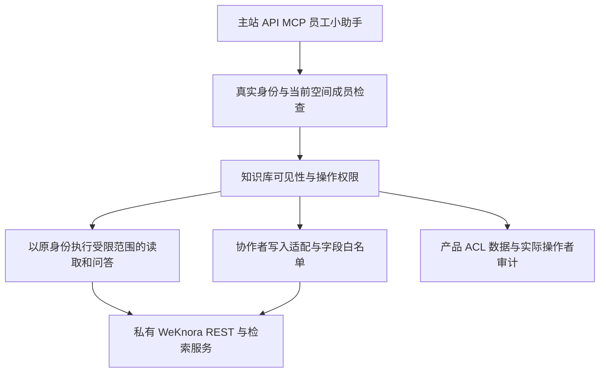

# MindCreek 知识库细粒度权限设计

日期：2026-10-18。状态：已获用户批准并完成产品代码实现，本地合成验收及限制见[验收记录](KNOWLEDGE_BASE_ACL_ACCEPTANCE.md)。尚未构建发布镜像、部署或进行企业数据切换。适用基线：MindCreek 原生空间运行方式与 WeKnora v0.8.0；[总体设计](../OVERALL_DESIGN_ZH.md)已同步本规则，上游源码保持未修改。

保留 Owner、Admin、Contributor（编辑）、Viewer（访客）四种空间角色，在产品网关增加知识库访问控制表。新建知识库默认仅创建者及本空间 Owner/Admin 可见；创建者可向全空间开放阅读，或指定可见成员，并给其他编辑分别授予文档、分块操作权限。Owner/Admin 始终可以访问和管理本空间全部知识库。

## 需求规则与推荐默认值

用户要求的规则：默认私有、空间公开或指定成员可见；可见知识库才能用于问答；协作编辑按操作授权；协作者不能修改知识库名称、配置或删除知识库；Owner/Admin 全库管理。

本方案补充以下推荐默认值，便于直接评审与实施：

- 可见同时允许用于问答、读取解析内容和获准引用，不自动授予下载原文件或写入权限。Viewer 保持现有问答导航，不新增知识库管理入口。
- 下载、写入只可授予当前空间的有效 Contributor；Viewer 只能获得可见权限。创建者降为 Viewer 后也受此上限约束。
- 协作权限作用于整个知识库内现有及未来文档、分块，不按上传者区分；首版不增加逐文档、逐分块或部门组授权。
- 创建者与 Owner/Admin 能管理可见范围和授权名单；协作者不能转授权。空间公开不支持再排除个别成员。
- “公开”仅表示当前空间有效成员可读，不表示匿名公开、全公司跨空间公开或可下载。
- 历史知识库迁移时默认收敛为创建者及管理者可见；无法可靠识别创建者的库先由 Owner/Admin 管理。原有跨空间共享和旧 API Key 需要单独盘点，不能自动绕过新规则。

## 可见范围与权限矩阵

界面显示三种可见范围：

| 范围 | 可见者 | 默认行为 |
|---|---|---|
| 仅创建者和空间管理者 | 创建者、本空间 Owner/Admin | 新建默认值 |
| 指定成员 | 上述人员及明确选中的本空间成员 | 未选择的人不能发现或访问该库 |
| 空间内公开 | 当前空间所有有效成员，包括以后加入的成员 | 所有人可读和问答，写入与下载仍逐人授权 |

存储采用 `restricted / workspace` 两种可见性，加独立成员授权。`restricted` 无授权记录时显示第一种，有记录时显示第二种。公开状态也可保留特定编辑的操作授权；切回受限状态时展示最终保留成员名单，不能留下隐藏的历史授权。

下表的创建者列要求其仍为有效 Contributor、Admin 或 Owner；“普通可见成员”包括仅获可见权限的编辑和访客。

| 操作 | Owner/Admin | 创建者 | 获操作授权的编辑 | 普通可见成员 | 不可见成员 |
|---|:---:|:---:|:---:|:---:|:---:|
| 看到知识库名称和获准内容 | ✅ | ✅ | ✅ | ✅ | ❌ |
| 用于检索、问答及引用读取 | ✅ | ✅ | ✅ | ✅ | ❌ |
| 上传或新增文档 | ✅ | ✅ | 按授权 | ❌ | ❌ |
| 修改文档 | ✅ | ✅ | 按授权 | ❌ | ❌ |
| 删除文档 | ✅ | ✅ | 按授权 | ❌ | ❌ |
| 下载文档原文件 | ✅ | ✅ | 按授权 | ❌ | ❌ |
| 修改分块 | ✅ | ✅ | 按授权 | ❌ | ❌ |
| 删除分块 | ✅ | ✅ | 按授权 | ❌ | ❌ |
| 使用分块导出功能 | ✅ | ✅ | 按授权 | ❌ | ❌ |
| 修改知识库名称与配置 | ✅ | ✅ | ❌ | ❌ | ❌ |
| 删除知识库 | ✅ | ✅ | ❌ | ❌ | ❌ |
| 设置可见范围、管理授权 | ✅ | ✅ | ❌ | ❌ | ❌ |

任一操作先要求身份有效、当前空间成员有效、资源确实属于该空间。平台管理员身份本身不增加其他空间的内容访问权。Owner/Admin 的全库权限属于人类管理角色，不自动等同于任意 API Key 的全库权限。

对知识库不可见时，详情、文档、分块和资源探测统一返回不泄露其存在性的结果；已经可见但缺某项操作权限时返回明确的权限不足。列表、搜索建议、标签统计及数量不能泄露不可见库的信息。

## 可独立授予的操作

| 权限 | 包含的操作 | 不隐含的权限 |
|---|---|---|
| `document.create` | 上传文件、导入网页、创建手工文档，以及新文档的正常解析入库 | 覆盖已有文档、修改配置、给自己新增授权 |
| `document.update` | 修改文档正文、名称、摘要、文档标签或目录归类 | 删除文档、修改知识库名称或配置、任意重建分块 |
| `document.delete` | 删除单篇或明确选择的多篇文档，包含这些文档的关联分块和索引 | 删除知识库、删除其他知识库内容 |
| `document.download` | 下载原始文件及返回同一原文件的预览 | 修改、删除、转授权 |
| `chunk.update` | 修改分块正文、启用状态及关联问题；相应索引更新 | 删除分块、修改原始文档 |
| `chunk.delete` | 删除指定分块及其关联索引 | 删除父文档、清空整个知识库 |
| `chunk.export` | 产品提供的分块下载或导出入口 | 原文件下载、写入 |

上传文档产生分块属于 `document.create` 的正常结果，不要求额外的分块权限。原生分块路由没有独立“上传分块”接口；首版不提供无对应能力的勾选项。产品分块导出使用 `POST /api/v1/mindcreek/kb-permissions/{kb_id}/export-chunks`，接收明确的 `knowledge_ids`，逐篇核验真实父 KB 后返回 JSON 附件；不以原文件下载替代分块导出。

会覆盖已有分块的重新解析、正文重建等操作，需要同时具备 `document.update`、`chunk.update`、`chunk.delete`。修改文档的不同请求字段必须分别映射实际副作用，不能借“修改标签”提交重解析配置。删除文档的级联影响在授权界面明示。

FAQ 与 Wiki 的操作映射如下；复合操作要求同时具备表内全部权限。

| 内容操作 | 所需权限 |
|---|---|
| 新增单条 FAQ | `document.create` |
| 修改 FAQ、添加相似问题、批量修改字段或条目标签 | `document.update`、`chunk.update` |
| 删除 FAQ 条目 | `document.delete` |
| 批量追加 FAQ（原生可能合并已有条目） | `document.create`、`document.update`、`chunk.update` |
| 替换模式批量导入 FAQ | 追加所需权限，以及 `document.delete`、`chunk.delete` |
| 导出 FAQ | `chunk.export` |
| 读取 Wiki 页面、版本、搜索、图谱及问题列表 | 可见 |
| 新建 Wiki 页面 | `document.create` |
| 修改、恢复版本或调整 Wiki 页面的目录归属 | `document.update` |
| 删除 Wiki 页面 | `document.delete` |

每个接口及字段都列入固定清单。FAQ 的条目编号及标签编号必须重新解析到当前 KB；禁止客户端指定导入任务 ID，协作者不能借 `tag_name` 新建全库分类。Wiki 的来源文档和引用分块逐个核验真实父 KB。改变全库分类或目录结构、初始化及解析配置保留给创建者或空间管理者，不混入普通文档修改。Wiki 自动重建、自动修复及问题状态写入尚无已验证的完整副作用契约，首版明确关闭。

协作者默认不能整库复制、复制配置、跨知识库移动、对外分享或通过智能体写工具扩大授权。这些操作影响源库与目标库或产生独立副本，不属于本期给出的七项权限。

阅读意味着客户端已得到相应解析文本，因此“禁止下载分块”只能限制产品导出功能，无法阻止复制文字、截图或自行保存已经读到的内容。原文件下载则可以独立控制：未授权时不下发原文件、原文件预览或可直接访问的存储链接。引用改用获准的解析内容及受保护图片。

## 问答与所有内容入口

一次检索的实际知识库范围为：

```text
当前有效身份和空间成员关系
∩ 当前可见知识库
∩ 用户本次选择的范围（有明确选择时）
∩ 智能体或渠道允许的范围（使用智能体或渠道时）
∩ API Key 的知识库范围与能力（机器请求时）
```

用户明确指定不可见 KB、文档、标签或分块时，整次请求在检索前拒绝。自动选库只选可见集合；集合为空时明确提示没有可用知识库，禁止把空列表交给上游解释成全空间。无知识库的普通对话仅在明确的非检索模式下运行。

智能体绑定私有知识库不构成向使用者授权。`all` 模式也只能检索当前使用者可见库；文档、标签及内部工具参数必须进一步收窄到相同范围。不能以智能体创建者、发布者或 Owner 身份替访客读取内容。对不能证明范围约束的工具先拒绝；协作用户的智能体内部写工具首版不开放，文档写入使用经过操作授权的页面或 API。

统一规则覆盖以下路径：

- 主站 KB 列表、详情、文档和分块接口，FAQ、Wiki、图谱、标签、文件夹、任务进度与统计。
- 普通问答、Agent 问答、员工网页小助手、四个只读 MCP 工具和机器 API。
- 引用、图片、文件、原文预览、FAQ/分块导出、历史消息及流式重连。
- 批量操作、复制、移动、重解析、版本回退以及所有 path、query、JSON、multipart 中的对象 ID。

现有会话已绑定使用过的 KB 集合。首版延续保守策略：其中任一库不再可见，停止该会话的后续读取、搜索和继续问答，提示用户新建会话；不尝试从历史回答中可靠拆除某个库的文字。访问引用和图片时再次验权。撤销不能收回已显示、已下载的内容；已提交原生异步任务也不能仅靠入口撤权保证立即中止。

## 当前实现可以复用的部分与缺口

| 当前实现 | 本次调整 |
|---|---|
| 四角色、企业身份、成员状态和隔离已有实现 | 复用原生身份和角色，不保存第二份可独立授予角色的事实源 |
| 原生同空间 KB 读取直接允许 | 新增产品 KB 可见性检查，替代同空间自动可见 |
| `ScopeService` 已在检索前解析并写入 KB 范围，绑定会话 | 引入 ACL 交集，覆盖主站、MCP、小助手和历史重校验 |
| 许多内容路由没有 `scope_session` 检查，部分 Wiki 路由的 checks 为空 | 为所有内容路由建立强制的操作权限映射；未知内容路由默认拒绝 |
| 原生仅允许创建者或 Admin 修改已有 KB 内容 | 给获授权协作者增加服务端受控写入适配 |
| 批量改标签、批量重解析缺创建者检查；整库复制权限较宽 | 按新操作表逐项授权，不能把旧行为当成新权限依据 |
| 原文件预览与下载读取同一文件 | 一起校验原文件下载权限；可见权限保留解析内容阅读 |
| KB 图片代理主要校验租户及路径，未充分绑定具体 KB | 增加可靠的资源归属校验，防止用可见 KB 路径获取私有 KB 的图片 |
| 旧 `grant` 服务及 viewer/editor 表保留在历史代码中，当前运行方式未注册 | 可复用审计、版本冲突和撤销经验；新建专用 ACL 模块，不恢复旧目录、订阅、个人笔记体系 |

源码依据：[原生 KB 访问](../../upstream/weknora/internal/middleware/kb_access.go)、[内容路由](../../upstream/weknora/internal/router/routes_knowledge.go)、[内容处理](../../upstream/weknora/internal/handler/knowledge.go)、[文件代理](../../upstream/weknora/internal/router/files.go)、[网关路由](../../services/gateway/internal/nativeaccess/gate.go)、[范围解析](../../services/gateway/internal/nativeaccess/scope.go)、[原生运行组成](../../services/gateway/cmd/gateway/native.go)。

## 产品侧实现方案



新增产品模块，例如 `internal/kbacl`，对外提供 `CanView`、`AllowedKnowledgeBases`、`AuthorizeAction`、`EffectivePermissions`。数据库异常、权限状态未知或操作未分类时拒绝请求。前端只根据服务端返回的有效权限显示按钮，不能成为最终鉴权依据。

新建产品迁移，不修改上游表或既有历史迁移。建议数据结构：

| 数据 | 必要字段与用途 |
|---|---|
| `kb_policies` | `tenant_id`、`kb_id`、可靠创建者绑定及其成员关系代次、创建者资格撤销状态、`visibility`、`revision`、创建/删除状态；以空间和 KB 作为联合边界 |
| `kb_member_permissions` | 空间、KB、原生用户 ID、可见标记、操作集合、授予人、版本、撤销状态；不使用姓名或邮箱作为主体键 |
| `kb_acl_events` | 实际用户、空间、KB、操作、目标、权限版本、前后差异、结果及请求 ID；不记录文档正文或凭据 |
| 资源与任务绑定 | 文档/分块/图片/导出资源/异步任务到 KB 的关联，以及任务发起者；只保存授权所需标识，不复制检索内容 |

创建者依据原生 `creator_id` 核验并绑定，不信任创建请求里的用户字段。成员角色以实时原生事实为准。创建者退出或被移除后，产品保留历史创建者身份，但撤销其当前创建者资格；重新加入不因相同 `creator_id` 自动恢复私有可见或管理权限，由 Owner/Admin 显式恢复。修改可见性和成员操作权限采用版本号或 `If-Match`，一次事务提交策略、成员变化和审计，防止并发覆盖。

产品授权接口建议使用 `/api/v1/mindcreek/kb-permissions/{kb_id}`，包含策略、成员授权和当前用户有效权限子接口。避免复用已由 R3 标记为 retired 的旧 `/mindcreek/knowledge-bases/.../grants` 命名空间。服务端为创建者提供最小化的本空间成员搜索，只返回授权所需的用户 ID、显示名及角色，不因此授予成员管理权限。

新建 KB 时先产生产品操作记录，再调用原生创建；成功绑定 ACL 后才向客户端返回完整可用结果。跨库创建和产品事务无法原子提交，应采用可恢复状态与幂等键；超时后先核对结果，不盲目重试生成多个 KB。缺少已完成 ACL 记录的库不向普通成员开放，管理者可查看恢复状态。

### 协作者写入适配

优先继续用真实用户身份处理本来就能通过上游检查的操作。对明确授权但被原生创建者规则阻挡的协作写入，网关完成身份、成员、KB、操作、字段及对象归属检查后，再用服务端保管的内部凭据调用固定原生 REST。

内部凭据优先采用限定 KB 的 `ingest` 能力 Key，必要时附加最小读取能力；不发给协作者，不采用全空间 `full_access` Key。原生 capability 本身不能区分上传、修改、删除，产品必须使用具体方法、路径及请求字段白名单；每个批量目标都要核验真实父 KB，不能只相信客户端的 `kb_id`。

复用现有空间委托的加密存储、撤销和审计机制，但现有 `manage_members` 服务 Key 不得扩权复用为内容 Key。Owner 启用协作写入执行能力时明确授权此用途；委托失效应拒绝协作者写入，不影响安全可用的普通读取。不同原生 API 身份模式的兼容性需要先验证；若只能使用 Owner 会话，则也必须限制到上述固定操作，并在产品审计中记录实际操作者与代理身份。

授权变更和新写入受理按 KB 串行化，并与现有身份状态锁、`workspace-admin:<tenant>` 成员变更锁协调；统一按身份、空间、KB 的固定顺序取得所需锁，多对象按稳定 ID 排序。当前身份、角色和权限版本的重查至上游受理必须处于同一保护边界，不能仅加 KB 锁而让空间降级或移除穿过校验。多副本网关使用数据库锁或经验证的同等版本栅栏。

定义受理为撤销的分界：撤销提交后的新操作必须拒绝；此前已被原生接收的写入或任务记录为已受理，不声称已经撤回。不要在通用反向代理中把所有协作者请求替换为管理凭据。

### 文件与派生内容

读取 KB 文件、图片、任务进度及错误详情前，验证对象实际所属 KB。文件路径中带租户或请求 URL 带 KB ID 都不足以证明归属。文档和分块 ID 通过原生对象关系核验；独立资源句柄则需要由服务端上传或解析流程建立的可信资源绑定。可编辑 Markdown、`image_info` 中出现相同路径不能证明资源归属，原生 `PUT /knowledge/image/...` 只是客户端图片元数据修改，也不能用它生成可信绑定。

图片修复版本通过固定上游版本的只读适配器，核验资源登记、不可由用户修改的多模态解析记录、文档所属知识库与当前 ACL；有可信解析记录的历史图片自动恢复。缺少证据时仍返回 `kb_acl.resource_binding_unavailable`，安装运维人员可独立核验后通过本地工具写入产品迁移 `000022` 的确认记录。真正的当前空间 Owner/Admin 可读取经过资源登记和原生租户校验的图片，知识库创建者不能仅凭该库管理权限获得这项全空间例外。不得按客户端声称的 KB、可见正文链接或原生 attachment 生命周期绑定放行。详见[图片修复方案](IMAGE_RESOURCE_ACL_FIX.md)。

FAQ 导入进度读取原生已认证、已校验租户的唯一任务快照；核对任务 ID、快照中的 KB 和文档 ID、文档真实父 KB 及当前可见性后，过滤并返回同一快照。缺少任何归属字段时拒绝。不能从截断的任务编号猜测 KB，也不能在校验后再次读取未经核验的新快照；失败明细的存储 URL 不直接下发。

不向无下载权限者返回可直接读取原文件的 `file_path`、存储 URL 或匿名签名 URL。原生 raw/presigned 出口继续关闭；资源经过鉴权代理，使用私有或不缓存策略。图库、Wiki、Neo4j 图谱等产品直连读取也调用同一个 ACL 服务。

首版仅支持本空间成员授权。受保护 KB 不通过旧组织共享或共享 Agent 自动授予其他空间访问；迁移时列出受影响共享并关闭未被新模型覆盖的出口。后续若保留跨空间共享，应另定义来源空间授权与目标空间有效成员的交集，不能只沿用上游宽松默认值。

### API Key 与机器身份

保留此前 Owner/Admin 的 Key 管理分工。机器仍是独立主体，不能因为原生 `auth/me` 返回 Owner 信息就获得全部私有库。

机器请求同时受原生 capability、Key 显式 KB 范围和产品操作范围约束。`retrieve` 不自动意味着原文件下载，`ingest` 不自动意味着本期七项操作全部开放；在产品侧记录所授操作，所有入口用同一映射检查。Key 不管理 KB 可见性或成员授权。

Owner 的全空间机器访问必须显式选择并记录“全部知识库，包括以后新建的私有库”；Admin Key 继续要求明确 KB 集合。历史 Key 在切换新 ACL 前完成范围映射：无法可靠解释的 Key 暂停知识访问，待 Owner 确认或重建。不得因缺少记录而恢复旧版全空间读取。内部执行 Key 单独保护，不出现在普通成员可复制的列表中。

## 页面交互

创建知识库时显示默认范围“仅创建者和空间管理者”；创建成功后可直接打开“访问与协作”。知识库列表提供“我创建的”“共享给我的”“空间公开”筛选；Owner/Admin 另有“全部知识库”。数量、搜索和分页均根据实际可见集合计算。

“访问与协作”包含可见范围和成员表。选中 Viewer 只显示“可见并用于问答”；选中 Contributor 可逐项勾选七项操作。勾选操作自动要求可见，移除可见同时移除该成员的全部操作；对公开库则提示该成员仍因空间公开而可见。每项权限旁解释删除级联、重新解析覆盖和原文件预览的含义。

页面可提供“仅查看”“上传协作”“内容维护”“自定义”快捷组合，但保存的是明确操作集合；默认不勾选删除或下载。协作者上传的内容沿用该 KB 的策略，不会因此变成创建者。

普通成员只看到自己的有效权限；完整授权名单和审计只向创建者及 Owner/Admin 开放。页面聚焦、空间切换、角色变化及权限更新后刷新授权状态；服务端返回权限不足时清理过期操作入口，不静默转用其他身份重试。

## 生命周期与迁移

| 事件 | 推荐规则 |
|---|---|
| 撤销某人的可见授权 | 同时撤销其操作权限；若仍为空间公开，只撤销操作，阅读保留 |
| 空间公开改为受限 | 原公开成员立即失去新请求访问；保留名单在保存前明确展示 |
| 协作者降为 Viewer | 写入、下载及导出授权撤销；可见授权可保留，升回 Contributor 不自动恢复已撤销操作 |
| 创建者降为 Viewer | 保留可见及问答，停止其写入和授权管理资格；Owner/Admin 继续管理该库 |
| 成员停用、移除或退出 | 所有新访问拒绝，撤销成员授权；重新加入不自动恢复旧授权 |
| 创建者退出或被移除 | 知识库保留，由 Owner/Admin 接管管理；不自动公开。重新加入须由 Owner/Admin 显式恢复创建者资格，或按普通成员重新授权 |
| 删除知识库 | 标记策略及授权已删除，资源和任务访问同步失效，保留必要审计 |

升级先盘点现存库、可靠创建者、共享关系、机器 Key 和资源绑定。普通历史 KB 默认转为受限；未知创建者只对 Owner/Admin 开放；系统历史索引等内部 KB 保留专用访问规则，不作为普通可公开知识库。旧订阅、旧 grant 和 Personal Notes 数据不直接转换为新授权。

切换前完成策略回填、所有入口鉴权和前端适配；不能先显示“私有”而后台仍全空间可读。禁止新旧网关混跑导致部分请求绕过 ACL。应用回退必须保持新授权检查或关闭知识访问；仅保留数据表而退回旧网关不安全。数据库 down 迁移拒绝删除仍有效的授权数据。

## 实施顺序与验收

| 阶段 | 交付与完成条件 |
|---|---|
| 一 接口契约验证 | 明确全部内容路由的权限映射；验证非空范围进入 Agent 工具、KB 限定内部凭据、文件归属和异步行为。无法安全覆盖的可选接口明确关闭 |
| 二 可见性闭环 | ACL 数据及审计、新建默认受限、公开/指定成员；覆盖列表、直链、检索、引用、历史、图片、Wiki、图谱、MCP、小助手和 API Key |
| 三 操作授权 | 七项独立权限、受控协作写入、批量与复合操作、角色变更和撤销竞争；补齐当前批量接口缺口 |
| 四 页面与升级 | 授权页面、按钮状态、Viewer 选库、历史数据迁移、备份恢复、混版本保护和发布证据 |

所有阶段完成前不宣称细粒度权限整体交付。验收至少包含：

1. 用 Owner、Admin、创建者 A、协作者 B、普通编辑 C、Viewer D 和另一空间用户验证权限矩阵；猜测 ID、路径及资源句柄也不能绕过。
2. 新建私有库在列表、名称搜索、统计、Agent、MCP、问答和引用中均不泄露给 C/D；授予 D 可见后仅该库进入其可用问答范围。
3. 七项权限逐个授予和撤销，正向用例成功，其他操作仍拒绝；上传者不能凭上传行为升级为 KB 管理者。
4. 通过检索调用记录证明授权前没有查询不可见库；空范围、Agent all 模式、文档/标签输入和内部工具不能扩大范围。
5. 测试原文件 preview、download、FAQ/分块导出、图片路径伪造、跨 KB 批量 ID、copy/duplicate、move、Wiki 及任务进度绕行。
6. 验证成员降级、离开、重新加入、撤销和并发写入；历史消息、引用、流式重连重新检查。明确已受理任务与已返回内容的边界。
7. 验证迁移重复执行、失败恢复、未知创建者、旧 Key、回退拒绝及多个网关副本；使用合成数据，并提供四角色界面的前后截图。

目标实现保持上游子模块干净。当前原生 REST、限定范围 Key 和产品网关提供了主要实现路径，但 Agent 内部工具与资源归属需要第一阶段契约验证；不能安全约束的能力先关闭。若必要能力最终确实缺少安全扩展接口，再按[上游补丁规则](../UPSTREAM_PATCHES.md)准备独立提案，不以本设计视为源码补丁批准。

## 实施说明：首版 Agent 安全边界

首版保留快速问答和采用已验证只读工具的智能推理。所有人（包括 Owner/Admin）的内容写入统一走知识库页面或受控 API；Agent 内部 Wiki 写工具暂不开放。这避免了在一次问答检查后、原生受理前，另一请求修改 Agent 配置引入新写工具的竞争。保存、复制及执行 Agent 均检查同一工具规则。

保存 Agent 配置必须关闭 MCP、Skills、Web 搜索并显式设置 `memory_enabled: false`，且 `sandbox_config_id` 为空。所有 Web 问答与 MCP ask 每次核验当前空间记忆关闭，以覆盖原生在 Agent 删除/加载失败时退回无 Agent 的窗口；未配置的原生空间记忆默认关闭，已开启或无法验证则拒绝问答。执行内置或旧只读 Agent 时，其缺省记忆值仅在空间记忆已核验关闭的条件下允许继承。原生的 `allowed_tools` 不控制其额外注册的 MCP、Web 和沙箱工具，因此仅过滤该数组不能建立隔离边界。缺省 MCP 模式在智能推理中意味着全部服务，也被拒绝。前端保存采用 `mcp_selection_mode: none`、`skills_selection_mode: none`、相应服务列表为空及上述开关关闭。已绑定非空 `sandbox_config_id` 的历史会话须新建会话；原生会话的沙箱绑定优先于后来修改的 Agent 配置。

允许的内置工具为 `thinking`、`todo_write`、`knowledge_search`、`grep_chunks`、`list_knowledge_chunks`、`get_document_info`、`query_knowledge_graph`、`data_schema`、`wiki_search`、`wiki_read_page`、`wiki_read_source_doc` 和 `wiki_read_issue`。其中涉及知识内容的工具必须使用原生 `SearchTargets` 的父 KB/文档边界。`database_query` 暂停：其行级范围约束不能替代敏感元数据列的控制。`data_analysis` 暂停：其知识 ID 检查不能约束随后对共享 DuckDB 执行的任意 SQL。恢复这些能力需单独完成其操作与数据范围契约验证。

原生 `is_temporary=true` 的历史索引或临时知识库不作为普通 ACL 对象，Owner/Admin 也不能通过权限页面将其设为空间公开。原有关键字历史搜索仍按会话绑定和当前 KB 可见性检查。
